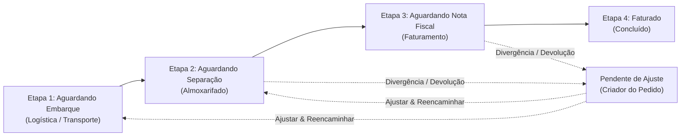

# 📦 Painel de Pedidos & Esteira Operacional TOTVS

Sistema corporativo de gestão e transição de status de pedidos em tempo real integrado ao fluxo operacional do ERP TOTVS. Desenvolvido para eliminar gargalos de comunicação por e-mail e planilhas, unificando a esteira entre os departamentos solicitantes, operacionais e fiscais.


---

## 🎯 Visão Geral da Esteira Operacional

O sistema gerencia o ciclo de vida completo de cada pedido através de uma esteira visual com 4 etapas sequenciais, controle de devoluções por divergência e priorização de urgência:



---

## 🏢 Departamentos e Regras de Negócio

| Departamento | Papel no Sistema | Permissões & Ações |
| :--- | :--- | :--- |
| **Comercial** | Solicitante | Inclui pedidos TOTVS, visualiza todas as etapas dos seus pedidos, edita e cancela antes de faturar. |
| **Assistência Técnica** | Solicitante | Inclui pedidos de peças/serviços, acompanha andamento em todas as etapas. |
| **Licitação** | Solicitante | Inclui pedidos de editais/órgãos públicos, acompanha a esteira completa. |
| **Logística** | Operacional | Realiza o **Embarque** (informando Romaneio e anexo opcional de comprovante/PDF). |
| **Almoxarifado** | Operacional | Realiza a **Separação física** e **Autorização de Faturamento** (Peso e Volume obrigatórios). |
| **Transporte** | Distribuição | Acompanha cargas em trânsito e visualiza **Observações de Entrega**. |
| **Faturamento** | Fiscal | Visualiza apenas etapas fiscais (Aguardando NF e Faturado), emite NF com múltiplos anexos de NF e boletos. |
| **T.I** | Administrador | Acesso total irrestrito: cria, embarca, separa, fatura, gerencia usuários, audita esteira global. |
| **Gerência / Supervisão** | Auditoria | Visão global de todas as etapas e métricas executivas em modo somente leitura. |

---

## ⚡ Principais Funcionalidades

- **🚨 Priorização de Urgência:** Pedidos urgentes possuem sinalizador visual animado em vermelho e prioridade automática no topo das filas.
- **🏷️ Tipos de Pedido:** Venda, Locação, Comodato, Demonstração, Transferência, Serviço e Insumo.
- **🔒 Privacidade Segmentada de Observações:**
  - *Observação de Separação:* Visível apenas para Logística, Almoxarifado, Criador e Administrador.
  - *Observação Fiscal:* Visível apenas para Faturamento, Criador e Administrador.
  - *Observação de Entrega:* Visível apenas para Transporte, Criador e Administrador.
- **📂 Gestão Centralizada de Documentos:** Upload e download direto de Romaneios, Notas Fiscais (múltiplas) e Boletos Bancários com 1 clique.
- **🔄 Gestão de Devoluções:** Operadores podem devolver pedidos com justificativa obrigatória; o criador ajusta e reencaminha diretamente para a etapa de origem.
- **📅 Filtro por Período & Botão Zerar Data:** Filtragem por data de criação (`De: XXX Até: XXX`) atualizando cards e listagem instantaneamente.
- **📄 Paginação Inteligente a cada 10 Pedidos:** Navegação fluida com contadores, páginas numéricas e controle de registros.
- **📊 Exportação para Excel (.CSV):** Exporta todos os pedidos filtrados com caracteres especiais e acentos em UTF-8 BOM e delimitador `;`.
- **🌐 Acesso na Rede Local da Empresa:** Servidor configurado para escutar em `0.0.0.0`, permitindo acesso por IP de outros computadores da rede interna.

---

## 🛠️ Tecnologias Utilizadas

- **Framework Web:** [Next.js 14](https://nextjs.org/) (App Router, Server Actions, API Routes)
- **Linguagem:** [TypeScript 5](https://www.typescriptlang.org/)
- **Estilização:** [Tailwind CSS](https://tailwindcss.com/) com suporte a Dark Mode / Light Mode
- **Ícones:** [Lucide React](https://lucide.dev/)
- **ORM & Banco de Dados:** [Prisma ORM](https://www.prisma.io/) com **SQLite** configurado em modo **WAL (Write-Ahead Logging)**
- **Autenticação:** JSON Web Token (JWT) assinado com cookies seguros HTTP-Only
- **Criptografia:** Bcrypt.js (hash de senhas com salt)

---

## 🚀 Como Executar o Projeto

### Pré-requisitos
- [Node.js](https://nodejs.org/) versão 18.17 ou superior
- npm ou yarn

### 1. Clonar o repositório
```bash
git clone https://github.com/SEU_USUARIO/painel-de-pedidos.git
cd painel-de-pedidos
```

### 2. Instalar dependências
```bash
npm install
```

### 3. Configurar variáveis de ambiente
Crie um arquivo `.env` na raiz do projeto (ou utilize o padrão):
```env
DATABASE_URL="file:./dev.db"
JWT_SECRET="sua-chave-secreta-corporativa-2026"
```

### 4. Inicializar o Banco de Dados
```bash
# Aplica a estrutura de tabelas
npx prisma db push

# Configura departamentos e cria o usuário administrador inicial
npm run db:reset
```

### 5. Iniciar o servidor de desenvolvimento
```bash
npm run dev
```

O sistema estará acessível em:
- **Local:** `http://localhost:3000`
- **Rede Local:** `http://SEU_IP_LOCAL:3000`

---

## 👤 Credenciais Iniciais de Acesso

Após a execução do reset/seed do banco de dados, o sistema conta com o usuário administrador exclusivo:

- **Usuário:** `admin`
- **Senha:** `admin123`
- **Departamento:** T.I (Acesso Total)

> 💡 **Nota:** Novos usuários e operadores de cada departamento devem ser cadastrados pelo menu **"Gestão de Usuários"** (`/admin/users`) pelo administrador.

---

## 🌐 Acesso em Rede Local (Outros Computadores da Empresa)

Para permitir que outros computadores da empresa acessem o painel:

1. Inicie o sistema no computador principal:
   ```bash
   npm run start
   ```
2. Descubra o IP da máquina servidora no Windows:
   ```powershell
   ipconfig
   # Exemplo de IP: 10.10.1.119 ou 192.168.1.50
   ```
3. Se necessário, libere a porta `3000` no Firewall do Windows (PowerShell como Administrador):
   ```powershell
   New-NetFirewallRule -DisplayName "Painel de Pedidos (Porta 3000)" -Direction Inbound -LocalPort 3000 -Protocol TCP -Action Allow
   ```
4. Nos outros computadores da rede, acesse pelo navegador:
   ```text
   http://10.10.1.119:3000
   ```

---

## ☁️ Deploy em Produção na VPS

### Opção 1: Com Node.js e PM2 (Recomendado)

```bash
# 1. Atualizar código na VPS
git pull

# 2. Instalar dependências
npm install --production=false

# 3. Aplicar banco de dados
npx prisma db push

# 4. Compilar versão de produção otimizada
npm run build

# 5. Iniciar ou reiniciar processo no PM2
pm2 start npm --name "painel-pedidos" -- start
# ou se já existir:
pm2 reload painel-pedidos
```

### Opção 2: Com Docker & Docker Compose

```bash
# Construir e subir container em background
docker compose up -d --build

# Visualizar logs
docker compose logs -f
```

---

## 📁 Estrutura de Diretórios

```text
├── prisma/
│   ├── schema.prisma         # Modelagem do banco (Department, User, Order, OrderHistory)
│   └── dev.db                # Banco de dados SQLite com WAL mode
├── public/
│   └── uploads/              # Armazenamento de Romaneios, NFs e Boletos
├── scripts/
│   ├── reset-db.js           # Script de reset e sanitização do banco
│   └── seed.js               # Seed inicial de departamentos e admin
├── src/
│   ├── app/
│   │   ├── (dashboard)/      # Telas autenticadas (Painel, Gestão de Usuários)
│   │   ├── api/              # Endpoints REST (auth, orders, upload, users)
│   │   └── login/            # Tela de autenticação
│   ├── components/           # Modais e componentes da interface
│   ├── lib/                  # Prisma Client, auth JWT, constantes
│   └── types/                # Definições de tipos TypeScript
├── package.json
└── README.md
```

---

## 🔒 Segurança e Otimizações Implementadas

- **Proteção contra Directory Traversal:** Sanitização de nomes de arquivos anexados e validação estrita de extensões permitidas (`.pdf`, `.xml`, `.xls`, `.xlsx`, `.png`, `.jpg`).
- **Prevenção de Ataques de Força Bruta:** Hash de senhas via `bcrypt` com fator de custo 10.
- **Sessões Seguras:** Cookies HTTP-Only com proteção SameSite.
- **Modo WAL no SQLite:** Permite leituras e gravações concorrentes de alta velocidade sem bloqueio de banco (`busy_timeout = 10000`).
- **Sanitização de Dados:** Mascaramento automático de observações restritas por departamento na camada de API.

---

## 📄 Licença

Uso interno corporativo. Todos os direitos reservados.
